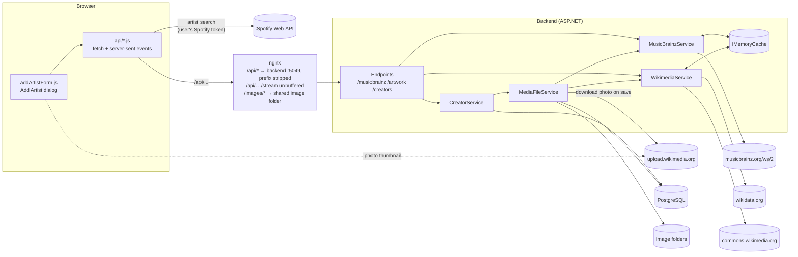
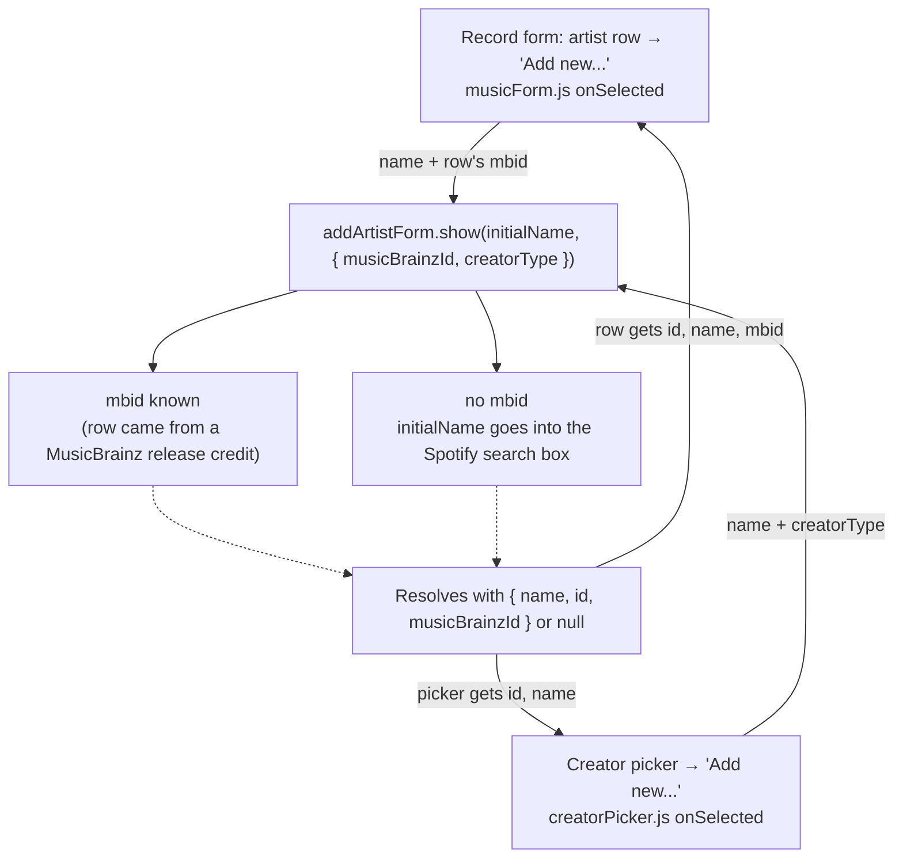
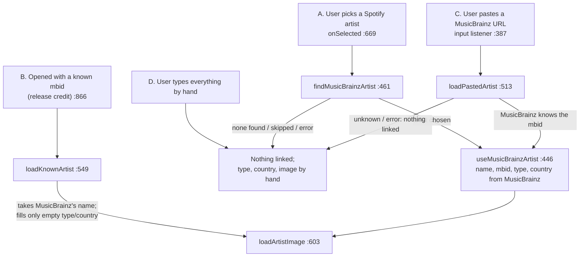
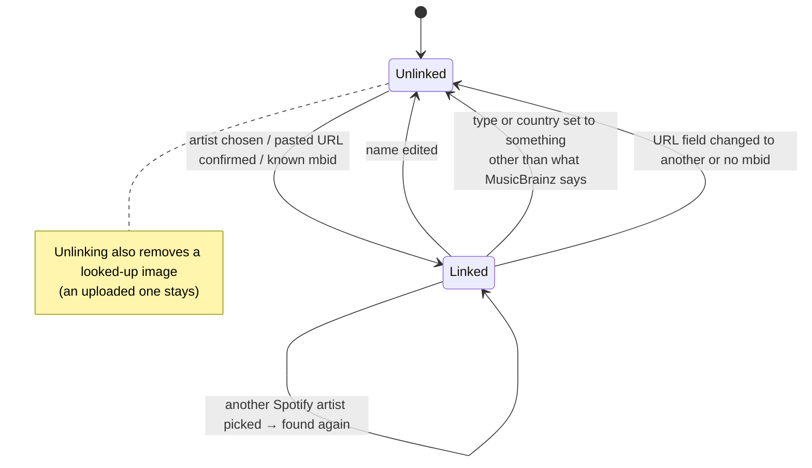
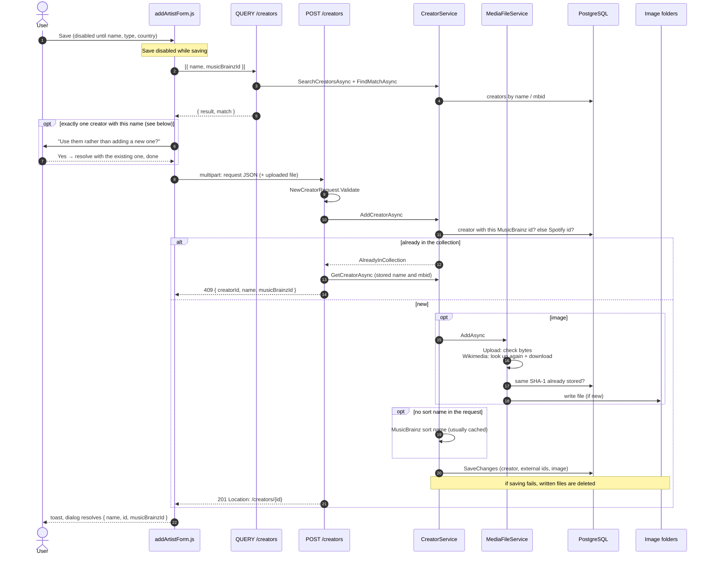
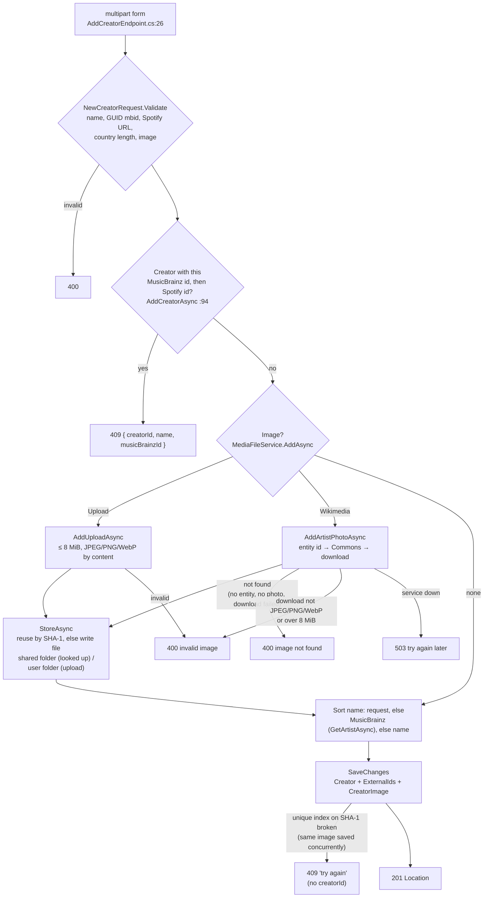

# Adding an artist

How the **Add Artist** dialog finds an artist on Spotify and MusicBrainz, gets their photo, and saves them, from the browser to the database.

> Line links point at the code as of this writing. If a link lands a few lines off, search for the function name next to it.

## The pieces



- **Spotify** is called straight from the browser with the user's own token ([spotify.js:6](frontend/js/api/spotify.js#L6)). The backend never talks to Spotify.
- **MusicBrainz and Wikimedia** are only called by the backend, which rate-limits and caches them (see [Caching and rate limits](#caching-and-rate-limits)).
- **Slow lookups** are streamed as server-sent events: `progress` events while the backend waits on MusicBrainz or Wikimedia, then one `result` or `error` event ([common.js:62](frontend/js/api/common.js#L62)).
  - `error` means the lookup failed and is worth retrying.
  - "Not found" is a `result` without data, which the frontend reads as `null`. ASP.NET writes a null item as an empty `data:` line ([common.js:108](frontend/js/api/common.js#L108)).
- **Every backend call needs the user's login token** (`/musicbrainz`, `/artwork` and `/creators` are all mapped with authorization). A 401 logs the user out ([common.js:26](frontend/js/api/common.js#L26)).
- **The lookup endpoints check their input before calling anyone:** a Spotify id must be 22 letters or digits, and an mbid must be a GUID. Anything else is a plain 400, which the frontend treats like any other failed lookup.

### nginx

The config isn't in this repository. It sits in front of both the frontend and the backend:

| Location | Goes to |
|---|---|
| `/` | Static frontend from `/var/www/cdarchive`, falling back to `index.html` |
| `/api/` | `http://localhost:5049/`, with the `/api` prefix stripped. The backend maps `/musicbrainz`, `/artwork` and `/creators` ([Program.cs:156](backend/Program.cs#L156), [:165](backend/Program.cs#L165), [:172](backend/Program.cs#L172)) |
| `~ ^/api/.+/stream$` | The same, but with buffering, caching and gzip off, and 300 s allowed between events. A regex location wins over the `/api/` prefix, so every lookup in this flow takes this route and its `progress` events arrive as they're sent |
| `/images/` | The shared image folder: looked-up photos and covers ([MediaUrlService.cs:19](backend/Services/MediaUrlService.cs#L19)) |
| `/protected-uploads/` | Internal only. Uploaded images are served through the backend, which answers with `X-Accel-Redirect` ([GetUploadEndpoint.cs](backend/Endpoints/Uploads/GetUploadEndpoint.cs#L39)) |

## Where the dialog is opened



| Step | Code |
|---|---|
| Record form opens the dialog | [musicForm.js:487](frontend/js/components/forms/musicForm.js#L487) |
| Creator picker opens it | [creatorPicker.js:144](frontend/js/components/creatorPicker.js#L144) |
| The dialog itself | [addArtistForm.js:41](frontend/js/components/addArtistForm.js#L41) |
| Starts with a known mbid, or with the Spotify search | [addArtistForm.js:866](frontend/js/components/addArtistForm.js#L866) |
| Record form keeps the chosen release if the row's mbid is unchanged, or the name is the same ignoring case | [musicForm.js:510](frontend/js/components/forms/musicForm.js#L510) |
| Cancel asks "Discard unsaved changes?" only if the name differs from the prefilled one, an image was uploaded, or a Spotify URL is filled in | [addArtistForm.js:823](frontend/js/components/addArtistForm.js#L823) |

The record form passes no `creatorType`, so its dialog starts with no type chosen. The creator picker passes the `creatorType` its credits list was created with ("Person" by default, [creditsList.js:29](frontend/js/components/creditsList.js#L29)). That preselects the Type dropdown when it is Person, Group or Other.

## How the form gets filled in

There are four ways in. All of them end in the same image lookup.



Line numbers are in [addArtistForm.js](frontend/js/components/addArtistForm.js). Lookups run one at a time ([runLookup :423](frontend/js/components/addArtistForm.js#L423)): starting one cancels the one in flight, and so does editing the name ([:855](frontend/js/components/addArtistForm.js#L855)).

### A. Spotify pick

```mermaid
sequenceDiagram
    autonumber
    actor U as User
    participant F as addArtistForm.js
    participant S as Spotify API
    participant B as Backend /musicbrainz
    participant MB as MusicBrainzService
    participant MBA as musicbrainz.org

    U->>F: types in the search box
    F->>S: GET /v1/search?type=artist
    S-->>F: artists
    U->>F: picks one
    Note over F: name and Spotify URL filled in;<br/>previous link, looked-up image,<br/>type and country cleared
    F->>B: GET /artists/by-spotify/stream?spotifyId=
    B->>MB: FindArtistsBySpotifyIdAsync
    MB->>MBA: GET url?resource=open.spotify.com/artist/{id}&inc=artist-rels
    MBA-->>MB: artists linking to the page (or 404)
    MB-->>F: event: result [artists]
    alt exactly one links to the page
        Note over F: that's them, no questions asked
    else several link to the page
        F->>U: confirmArtist.choose among the linked artists
        U-->>F: an artist, or Skip
    else none links to the page
        F->>B: GET /artists/stream?name=
        B->>MB: SearchArtistsAsync
        MB->>MBA: GET artist/?query=artist:"name"
        MBA-->>MB: up to 10 artists
        Note over MB: keeps names equal up to case,<br/>accents, punctuation, word order
        MB-->>F: event: result [artists]
        F->>U: confirmArtist.choose (even for one)
        U-->>F: an artist, or Skip
    end
    Note over F: useMusicBrainzArtist: MusicBrainz's name,<br/>mbid, type ("Other" if none), country
    F->>F: loadArtistImage(mbid)
```

| Step | Code |
|---|---|
| Spotify search | [addArtistForm.js:652](frontend/js/components/addArtistForm.js#L652), [spotify.js:27](frontend/js/api/spotify.js#L27) |
| Pick handler | [addArtistForm.js:669](frontend/js/components/addArtistForm.js#L669) |
| Spotify link first, name search as fallback | [addArtistForm.js:461](frontend/js/components/addArtistForm.js#L461) |
| Frontend wrappers | [musicbrainz.js:117](frontend/js/api/musicbrainz.js#L117), [:103](frontend/js/api/musicbrainz.js#L103) |
| Endpoints | [GetArtistsBySpotifyIdFromMusicBrainzEndpoint.cs:23](backend/Endpoints/MusicBrainz/GetArtistsBySpotifyIdFromMusicBrainzEndpoint.cs#L23), [GetArtistsFromMusicBrainzEndpoint.cs:21](backend/Endpoints/MusicBrainz/GetArtistsFromMusicBrainzEndpoint.cs#L21) |
| Service | [FindArtistsBySpotifyIdAsync](backend/Services/External/MusicBrainzService.cs#L279), [SearchArtistsAsync](backend/Services/External/MusicBrainzService.cs#L231) |
| Chooser | [confirmArtist.js:79](frontend/js/components/confirmArtist.js#L79) |
| Filling in | [useMusicBrainzArtist](frontend/js/components/addArtistForm.js#L446) |

More about this path:
- **The search box is disabled until the user has logged in to Spotify** ([addArtistForm.js:687](frontend/js/components/addArtistForm.js#L687)). An expired Spotify token is refreshed before the search ([spotify.js:7](frontend/js/api/spotify.js#L7)).
- **The name search finds up to 10 artists** with the Lucene query `artist:"name"`, then keeps those whose names match. Exact spellings come first, then the rest by MusicBrainz score.
- **MusicBrainz types are mapped to ours** ([MapType](backend/Services/External/MusicBrainzService.cs#L523)): Person → Person; Group, Orchestra and Choir → Group; anything else, such as Character, → Other. With no type, the form picks "Other", because an artist must have a type to be saved.
- **A failed lookup** shows a status line with Retry. "MusicBrainz doesn't know this artist" and Skip leave the form as it is, for the user to fill in by hand.

### B. Known mbid and C. pasted URL

Both call `GET /api/musicbrainz/artist/stream?mbid=` ([musicbrainz.js:127](frontend/js/api/musicbrainz.js#L127) → [GetArtistFromMusicBrainzEndpoint.cs:21](backend/Endpoints/MusicBrainz/GetArtistFromMusicBrainzEndpoint.cs#L21) → [GetArtistAsync](backend/Services/External/MusicBrainzService.cs#L346)).

| | B. Known mbid ([loadKnownArtist](frontend/js/components/addArtistForm.js#L549)) | C. Pasted URL ([loadPastedArtist](frontend/js/components/addArtistForm.js#L513)) |
|---|---|---|
| Linked while the lookup runs | Yes | No |
| Name | MusicBrainz's, with *credited as "…" on this release* under it when the credit differs | MusicBrainz's |
| Type and country | Only filled if still empty | Overwritten |
| User's own choice contradicts MusicBrainz | Unlinked, no image fetched | (n/a) |
| Merged artist (MusicBrainz returns another id) | Linked to the returned id | Linked to the returned id |
| MusicBrainz doesn't know the mbid | **Stays linked**, and the photo is still looked up (and won't be found) | Nothing linked, the URL stays for the user to correct |
| MusicBrainz unreachable | Stays linked, no image, Retry offered | Nothing linked, Retry offered |

### Credited names

A release may credit an artist by a name that isn't theirs: *American Fool* credits "John Cougar", who is John Mellencamp. The artist is always saved under MusicBrainz's name, and the release keeps the credit:
- **Add Artist renames a credited artist.** Opened from a credit (B), the dialog swaps the name for MusicBrainz's once it has it, and shows *credited as "John Cougar" on this release* under the field. Typing in the name field, picking a Spotify artist or pasting a URL hides the caption. The rename isn't an unsaved change. If MusicBrainz can't be asked, the credited name stays and can be saved.
- **The music form keeps the credit.** Each artist row has a hidden credited name, filled from the MusicBrainz release's artist credit (Spotify's names aren't per release, so they aren't kept). Once the row is resolved, the box shows the artist's own name with the same caption under it ([updateCreditedNameCaption](frontend/js/components/forms/musicForm.js#L545)). Typing in the box, or picking another artist than the credited one, drops the credit.
- **The backend stores the credit on the release** in `ReleaseCreator.CreditedName`, or null when it's the artist's own name ([AddReleaseAsync](backend/Services/ReleaseService.cs#L157)). The dashboard and the detail page show the credited names. The shelf still sorts by the artist's sort name, so *American Fool* sits with John Mellencamp's other albums.

## Linking and unlinking

The hidden mbid, the MusicBrainz URL field and a looked-up image always belong together. `musicBrainzValues` remembers what MusicBrainz said, so the form can tell filling in a gap from contradicting it.



| Rule | Code |
|---|---|
| `setMusicBrainzId` keeps the mbid, the URL field and `musicBrainzValues` together | [addArtistForm.js:264](frontend/js/components/addArtistForm.js#L264) |
| Unlink (and drop the looked-up image) | [:271](frontend/js/components/addArtistForm.js#L271), [:232](frontend/js/components/addArtistForm.js#L232) |
| Contradiction check, on settled values only | [:279](frontend/js/components/addArtistForm.js#L279), called from [country picked :353](frontend/js/components/addArtistForm.js#L353), [country typed in full :375](frontend/js/components/addArtistForm.js#L375), [type changed :862](frontend/js/components/addArtistForm.js#L862) |
| A missing MusicBrainz type arrives as `null` (not "Other") | [MapType](backend/Services/External/MusicBrainzService.cs#L523), [toMusicBrainzValues :289](frontend/js/components/addArtistForm.js#L289) |
| Editing the name also clears the Spotify URL, linked or not, since it's another artist | [:859](frontend/js/components/addArtistForm.js#L859) |

Picking another Spotify artist goes through Unlinked: the old link, image, type and country are cleared first, and then the new artist is looked up.

## The artist's photo

```mermaid
sequenceDiagram
    autonumber
    participant F as addArtistForm.js
    participant B as Backend /artwork
    participant MB as MusicBrainzService
    participant W as WikimediaService
    participant MBA as musicbrainz.org
    participant WD as wikidata.org
    participant C as commons.wikimedia.org
    participant UP as upload.wikimedia.org

    F->>B: GET /artist/stream?mbid=
    B->>MB: GetWikidataEntityIdAsync
    alt cached (also filled by GetArtistAsync)
        MB-->>B: entity id or none
    else
        MB->>MBA: GET artist/{mbid}?inc=url-rels
        MBA-->>MB: artist + relations
        Note over MB: caches the entity id and the artist
    end
    alt no entity id (unknown artist or no Wikidata link)
        B-->>F: event: result (no data → null)
        Note over F: "No image found, you can upload one yourself"
    else
        B->>W: GetImageAsync(entityId)
        W->>WD: wbgetclaims P18 (image)
        WD-->>W: Commons file name
        W->>C: imageinfo (500px URL, author, license)
        C-->>W: URLs + metadata
        W-->>F: event: result { url, author, license, ... } or null
        F->>UP:  (browser loads the thumbnail)
        Note over F: imageIsLookedUp = true, credit shown
    end
    Note over B,F: "no photo" is a null result;<br/>a failed service is an error event (Retry offered)
```

| Step | Code |
|---|---|
| Frontend | [loadArtistImage](frontend/js/components/addArtistForm.js#L603), [artwork.js:21](frontend/js/api/artwork.js#L21) |
| Endpoint | [GetArtistArtwork.cs:21](backend/Endpoints/Artwork/GetArtistArtwork.cs#L21) |
| Wikidata entity id (shares one request with `GetArtistAsync`) | [GetWikidataEntityIdAsync](backend/Services/External/MusicBrainzService.cs#L322), [FetchArtistWithRelationsAsync](backend/Services/External/MusicBrainzService.cs#L490) |
| Wikimedia | [GetImageAsync](backend/Services/External/WikimediaService.cs#L43), [FetchAsync](backend/Services/External/WikimediaService.cs#L65), [GetImageFileNameAsync](backend/Services/External/WikimediaService.cs#L118) |

Errors and retries:
- **Requests are retried** on 429, 500 and 503, up to 3 attempts, and the rate limiter respects `Retry-After` ([Utilities.cs:110](backend/Common/Utilities.cs#L110)). Each retry is sent as a `progress` event.
- **An `error` event follows** when all attempts fail, or when anything else goes wrong, such as a 502 or a network error. The latter come with the message "External service unavailable".

Which photo:
- **If the Wikidata entity has several photos**, the one ranked "preferred" wins, otherwise the first that isn't deprecated ([GetImageFileNameAsync](backend/Services/External/WikimediaService.cs#L118)).
- **The URL shown is a 500px rendition.** The original's URL, author and license come along for the credit.
- **Only Wikimedia hosts are accepted** (`upload.wikimedia.org` and a few more). Any other URL in the answer is dropped.

What happens to the photo:
- **Only the looked-up URL is shown.** Nothing is stored until the user saves, and on save the backend fetches the photo again itself (see below).
- **An uploaded file wins.** A lookup never replaces it, and uploading or removing an image cancels a lookup in progress ([addArtistForm.js:195](frontend/js/components/addArtistForm.js#L195)).

## Saving



What the request contains:

| Field | From |
|---|---|
| `name` | Name field, trimmed |
| `sortName` | Always `null`: the backend gets it from MusicBrainz, or uses the name |
| `type`, `country` | Type and country fields |
| `musicBrainzId` | Hidden mbid, or `null` |
| `spotifyUrl` | Spotify URL field, or `null` |
| `image` | `{ source: "Wikimedia", externalId: mbid }` for a looked-up photo of the linked artist, `{ source: "Upload", fileIndex: 0 }` for an upload, else `null` |

Built in [save()](frontend/js/components/addArtistForm.js#L734) and sent by [addNewCreator](frontend/js/api/backend.js#L95). The same-name check is [findSameNamedCreator](frontend/js/components/addArtistForm.js#L718) → [findCreators](frontend/js/api/backend.js#L62) → [SearchCreatorsEndpoint.cs:23](backend/Endpoints/Creators/SearchCreatorsEndpoint.cs#L23).

### The same-name check

The backend only recognizes an artist already in the collection by their MusicBrainz or Spotify id. An artist added by hand has neither, so without this check it would be added again. `QUERY /creators` returns two things:
- `result`: up to 20 of the user's creators whose name or sort name *contains* the name.
- `match`: the creator the name clearly stands for, from [FindMatchAsync](backend/Services/CreatorService.cs#L60), or null.

How `match` is found:
1. **The creator linked to this mbid, if there is one.** The frontend then asks nothing, since the POST will answer 409 with that creator anyway.
2. **Otherwise, creators with exactly this name**, ignoring case but not accents. When the new artist has an mbid, creators with *any* MusicBrainz link are skipped, because they are someone else with the same name.
3. **It's a match only if exactly one creator is left.** With two same-named creators, nothing is asked.

The user is only asked when the match is also among the `result` creators. A creator matched in step 1 under another name ("2Pac" for "Tupac") isn't, so they aren't asked. If the check itself fails, the artist is saved without asking.

### Inside `POST /creators`



| Step | Code |
|---|---|
| Endpoint, status codes | [AddCreatorEndpoint.cs:26](backend/Endpoints/Creators/AddCreatorEndpoint.cs#L26), [409 :70](backend/Endpoints/Creators/AddCreatorEndpoint.cs#L70), [others :82](backend/Endpoints/Creators/AddCreatorEndpoint.cs#L82) |
| Validation | [Creator.cs:30](backend/Data/DTO/Creator.cs#L30), [Image.cs:22](backend/Data/DTO/Image.cs#L22) |
| Duplicates, image, sort name, save | [CreatorService.cs:88](backend/Services/CreatorService.cs#L88) ([:94](backend/Services/CreatorService.cs#L94), [:103](backend/Services/CreatorService.cs#L103), [:123](backend/Services/CreatorService.cs#L123), [:143](backend/Services/CreatorService.cs#L143)) |
| Images | [AddAsync](backend/Services/MediaFileService.cs#L68), [AddUploadAsync](backend/Services/MediaFileService.cs#L98), [AddArtistPhotoAsync](backend/Services/MediaFileService.cs#L116), [DownloadAsync](backend/Services/MediaFileService.cs#L153), [StoreAsync](backend/Services/MediaFileService.cs#L194) |

More about saving:
- **The Spotify id is taken from the Spotify URL field** ([GetSpotifyId](backend/Data/DTO/Creator.cs#L55)). Share links with `/intl-xx/` or `?si=...` are accepted. A URL typed by hand that isn't a Spotify artist URL fails validation.
- **The saved photo is the 500px rendition the user saw**, downloaded again from `upload.wikimedia.org`, not the original. The original's URL and the credit are stored with it.
- **Looked-up photos are shared by everyone.** They're written to the shared folder without an owner, so two users adding the same artist store one file. Uploads belong to the user, and a user's identical uploads are stored once.
- **Each user has their own creators**, even for the same artist, so the duplicate checks only look in the user's own collection.

### What the frontend does with the answer

| Answer | Form |
|---|---|
| 201 | "added" toast, resolves with what it sent |
| 409 with `creatorId` | "already in your collection" toast, resolves with the **stored** name and mbid |
| 409 without `creatorId`, 400, 503, network error | error toast with the backend's `message`, or just "HTTP 400" for a failed validation, which has no message. The **dialog stays open** to retry or fix |
| Same-name check: Yes | resolves with the existing creator, nothing is sent |

## Caching and rate limits

Everything external is cached in memory, per backend process, and lost on restart.

| Cache key | Holds | Filled by | Kept |
|---|---|---|---|
| `mb:artist-search:{NAME}` | Filtered name search | `SearchArtistsAsync` | 24 h |
| `mb:spotify-artist:{id}` | Artists linking to a Spotify page | `FindArtistsBySpotifyIdAsync` | 24 h |
| `mb:artist:{mbid}` | One artist | `GetArtistAsync`, and also the two above and `GetWikidataEntityIdAsync` | 24 h |
| `mb:wikidata:{mbid}` | Wikidata entity id, or none | `GetWikidataEntityIdAsync`, and also `GetArtistAsync` | 24 h |
| `wiki:image:{entity}` | Photo URL and credit | `WikimediaService.GetImageAsync` | 7 days found, 12 h not |

- **Failures aren't cached:** a "MusicBrainz/Wikimedia unavailable" answer is removed again, so the next try asks again.
- **Rate limits:** at most one MusicBrainz request per 1.1 s and one Wikimedia request per 0.75 s across all users ([RateLimiter.cs:55](backend/Common/RateLimiter.cs#L55), [:61](backend/Common/RateLimiter.cs#L61)).

MusicBrainz requests per path, without cache hits:

| Path | Before saving | While saving |
|---|---|---|
| A. Spotify pick, linked on MusicBrainz | 1 (URL lookup) + 1 (photo) | 0 |
| A. Spotify pick, found by name | 1 (URL lookup) + 1 (search) + 1 (photo) | 0 |
| B. Known mbid | 1 (artist, which also answers the photo's lookup) | 0 |
| C. Pasted URL | 1 (artist) | 0 |
| D. By hand, no link | 0 | 0 |

These counts assume each request succeeds the first time. Some cases cost more:
- **A known mbid that MusicBrainz doesn't know** costs 2 requests: the 404 caches no Wikidata entity, so the photo lookup asks again.
- **A merged artist** (B or C) costs 1 more. The photo is looked up by the new id, which isn't cached yet.
- **Retries** add a request each (see [The artist's photo](#the-artists-photo)).

On save, the sort name and the photo's Wikidata entity are normally already cached by the lookups above. Wikimedia's photo info is cached for 7 days. The photo download itself goes to `upload.wikimedia.org` and isn't rate-limited.

## Known quirks

- **A known mbid stays linked even if MusicBrainz doesn't know it** (e.g. the artist was deleted), so the creator is saved with that mbid.
- **A looked-up GIF photo can be shown but not saved.** Commons serves GIF thumbnails as GIF, which the save rejects with "The image must be a JPEG, PNG or WebP file of at most 8 MiB". That message reads as if it were about an uploaded file.
- **Progress messages always mention MusicBrainz.** [describeProgress](frontend/js/api/musicbrainz.js#L175) is also used while waiting on Wikimedia, so a slow Wikimedia shows "Waiting for MusicBrainz..." or "MusicBrainz is busy...".
